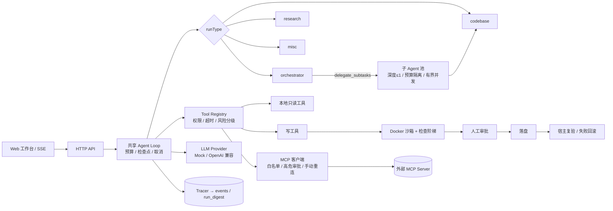

# multi-tool-agent

一个**轻量级 Agent Runtime（MVP）**：用**同一个共享 Agent Loop** 驱动两种任务——

- **Codebase Agent**：分析本地仓库（搜索 / 读取代码、在受限条件下运行测试）。
- **Research Agent**：检索公开信息、读取网页、提取证据、生成带来源引用的报告。

> 本仓库是「可运行、可测试、可演示」的 MVP，不是生产系统。所有「未实现 / 未验证」的部分都在下文与 `docs/ARCHITECTURE.md` 的「已知缺陷与未完成项」中**明确标注**，不会用「已支持 / 已完成」掩盖。

---

## 1. 快速开始

```bash
# 1) 安装依赖（better-sqlite3 需要 native build，npm 11 需先批准脚本）
npm install
npm install-scripts approve better-sqlite3 esbuild   # 或 npm rebuild
# 2) 类型检查
npm run typecheck
# 3) 运行测试（无需任何 API Key，使用 Mock LLM）
npm test
# 4) 运行三个演示（Mock 模式，内存数据库）
npm run demo:codebase
npm run demo:research
npm run demo:misc        # 杂项 Agent：只读清点 + 结构化结论
npm run demo:orchestrator # 多 Agent 编排：主 Agent 拆分 → 并行子 Agent → 汇总核验
# 5) 契约文档与门禁（文档从契约生成，防止"文档与实现漂移"）
npm run agents:docs      # 从 src/agents/specs.ts 生成 agents/*.md
npm run agents:lint      # 契约一致性门禁：自校验 + 文档漂移 + 工具存在性
# 6) 首跑体检（Node ABI / Embedding 服务 / Docker 镜像 / 端口 / Key；有 fail 退出 1）
npm run doctor
# 7) 启动 HTTP 服务 + 前端
npm start
#   打开 http://localhost:3000   （默认端口由 PORT 环境变量控制，如 PORT=3939 npm start）
#   默认打开「实时」页签：思考文本逐字输出 + 工具调用卡片（状态/参数/结果）
# 8) 实时流式链路冒烟（真实 HTTP + SSE，打印每帧明细与延迟统计）
npm run smoke:stream
# 9) 可选评测（编辑管线需 Docker；红队不需要 Key）
npm run eval:edit          # 12 个编辑管线场景（E1~E7 基线 + R1~R5 返工环）→ reports/EDIT_EVAL.md
npm run eval:edit:real -- --tasks=26 --budget-usd=1 --timeout-ms=240000  # 26 条真实模型任务（20 引导 + 4 盲测 + 2 多文件；需 Docker + DEEPSEEK_API_KEY，约 $0.03）→ reports/EDIT_EVAL_REAL.md
npm run eval:compaction    # 上下文压缩 A/B（30 run；需 DEEPSEEK_API_KEY，约 $0.03）→ reports/COMPACTION_AB.md
npm run security:redteam   # 42 条注入样本 → reports/INJECTION_REDTEAM.md
npm run digest:list         # 每次 run 的复盘摘要（成功也记；默认只看有问题的）
npm run stats:subtasks      # 按 spec 聚合子任务成功率/耗时（默认排除 Mock；不建新表）
npm run perf:stream-ui -- --events=50000   # 真实浏览器长流式渲染开销 → reports/UI_STREAM_PERF.md（需 Edge/Chrome）
# MCP 真实 server 探针（token 只从环境变量读，不落盘）：
#   MTA_MCP_PROBE_URL=http://127.0.0.1:8900/mcp MTA_MCP_PROBE_TOKEN=... npm run mcp:probe
npm run mcp:e2e             # 真实模型自主调用 MCP 工具（本地 /mcp + 真 DeepSeek；需 DEEPSEEK_API_KEY）
npm run e2e:write           # 写能力全链路：HTTP → 沙箱 → 审批 → 落盘 → 宿主复验（需 Docker + Key）
```

> **⚠️ 常见坑：`ERR_DLOPEN_FAILED` / `NODE_MODULE_VERSION 不匹配`**
> `better-sqlite3` 是原生 C++ 模块，按「安装时的 Node 版本」编译，一次只能匹配一个版本。如果你机器上有多个 Node（例如系统 `D:\Program Files\nodejs` 是 v24，另有 v22），用 A 版本装的依赖、用 B 版本跑就会报：
> `The module ... better_sqlite3.node was compiled against a different Node.js version using NODE_MODULE_VERSION 127. This version of Node.js requires NODE_MODULE_VERSION 137.`
> 现象是「不碰 SQLite 的测试通过、碰数据库的全挂」。
>
> **修复**（关键：必须先删掉旧的 `build/` 目录，否则 `prebuild-install` 看到已有文件会跳过、什么都不重建）：
> ```bash
> # 用你实际要运行的那个 Node 来执行；PowerShell 里直接敲即可
> rm -rf node_modules/better-sqlite3/build
> npm rebuild better-sqlite3
> npm test          # 应 422/422 通过
> ```
> 上面删不掉或重建仍失败时，用强制重装：
> ```bash
> rm -rf node_modules/better-sqlite3
> npm install
> ```
>
> **自查**：`node -v` 看当前版本；PowerShell 里 `where node`、Git Bash 里 `which -a node` 看机器上有几个 Node。
> 注意：换一个 Node 版本运行，就需要再重建一次——这是原生模块的正常现象，不是项目故障。

- LLM 默认 **Mock 模式**（无需 Key）。
- 启用真实 LLM：**DeepSeek 已端到端验证**（2026-10-13，真实 API 跑通完整 Agent Loop，含工具调用与流式思考）。在 `.env` 配置 `LLM_MODE=openai` + `LLM_PROVIDER=deepseek` + `DEEPSEEK_API_KEY=...`，或直接在界面上选 DeepSeek 并填 Key（见 §2.1）。其它预设（openai/qwen/moonshot/zhipu/ollama）代码路径相同但**本环境无 Key、未实测**。
- 启用真实联网搜索：配置 `SEARCH_PROVIDER=serper` + `SEARCH_API_KEY=...`。**该路径已实现但未经端到端验证**（本环境无 Key）。
- **也可以直接在界面里配**：启动服务后打开前端，展开左侧「LLM / 搜索 / 实时流 配置」面板即可选服务商、选模型、填 Key、调参数，无需改 `.env`、无需重启。详见 §2.1 与 `docs/LLM_CONFIG.md`。
- **运行测试是显式能力**：`run_tests` 默认关闭（默认只读）。需要时在任务参数里勾选「允许运行测试」，或设 `CODEBASE_RUN_TESTS_ENABLED=1`。未开启时它不会进入工具池。
- **完整演示脚本**：见 `docs/DEMO.md`（10 分钟主路径 + 每步预期 + 常见失败）。

### 1.1 预期输出（每步应该看到什么）

| 命令 / 操作 | 预期 |
| --- | --- |
| `npm install` | 无 `ERR_DLOPEN_FAILED`；better-sqlite3 与当前 Node 24 匹配 |
| `npm run typecheck` | 无输出（0 错误） |
| `npm test` | `tests 416 / pass 416 / fail 0`（Docker 未启动时 `40j` 跳过，其余必须全绿） |
| `npm run demo:codebase` | `status=completed`，4 步 / 4 次模型 / 3 次工具；示例仓库测试 6/6 |
| `npm run demo:research` | `status=completed`，4 步 / 3 次工具；首行标注「基于 MOCK 离线资料」 |
| `npm run demo:misc` | `status=completed`，2 步；输出结构化结论 |
| `npm run demo:orchestrator` | 2 个子任务并行且均 `ok`；汇总里如实列出未解决项 |
| `npm run agents:lint` | 三项门禁全过 |
| `npm run doctor` | Node / 数据目录 / 端口 / Embedding 探针为 ok；Docker 与 Key 可为 warn（sqlite-vec 只作为旧表兼容项） |
| `npm start` | 打开 `http://localhost:3000`，右侧五个页签：实时 / 事件流 / 流程监控 / 错误 / 复盘 |

### 1.2 最小验证路径（怀疑环境有问题时按这个顺序）

```bash
npm run typecheck          # 1) 编译
npm test                   # 2) 全量回归
npm run demo:codebase      # 3) 真实跑一次 Agent Loop（Mock）
npm run doctor             # 4) 环境体检
npm start                  # 5) 打开 UI，提交一个 codebase 任务
```

任何一步不符合上表，先停在那一层排查，不要直接怀疑模型或业务逻辑。

### 1.3 常见失败

| 现象 | 原因 | 处理 |
| --- | --- | --- |
| `ERR_DLOPEN_FAILED` / `NODE_MODULE_VERSION` | 原生模块按另一个 Node 版本编译 | 删 `node_modules/better-sqlite3/build` → `npm rebuild better-sqlite3` |
| 模型调了 `run_tests` 但没执行 | 默认关闭（安全默认） | 勾选「允许运行测试」，或设 `CODEBASE_RUN_TESTS_ENABLED=1` |
| 写能力开关置灰 | `CODEBASE_WRITE_ENABLED=false` | 改环境变量并重启 |
| 端口被占用 | 3000 被其它进程占用 | `PORT=3939 npm start` |
| 改了代码但行为没变 | `npm start` 无热重载 | 重启服务；开发用 `npm run dev` |
| 复盘显示「完成，但过程另有问题」 | 过程里确有工具失败/审批拒绝等 | 在「复盘」页看首个问题与 seq，不要只看最终状态 |
| 测试卡住 | Docker 未启动或镜像缺失 | 启动 Docker；`node scripts/sandbox/build-image.mjs` |

---

## 1.5 架构一图看懂



三条结构性不变量（不靠提示词自觉）：

1. **工具池单一真值**：主 Agent、子 Agent、HTTP 回显共用同一份过滤结果（`toolPoolFor` / `subAgentToolNames`）。
2. **写能力 fail-closed**：未授权 / 无沙箱 / 无审批通道 → 直接拒绝；落盘失败不伪装成功。
3. **不可信输入不升权**：工具输出命中注入特征后，本 run 禁用粘性自动放行，高危动作仍需当前批次二次确认。

## 2.1 在界面上配置 LLM（推荐：不用改 .env）

启动 `npm start` 后打开 http://localhost:3000 ，左侧展开 **「LLM / 搜索 / 实时流 配置」**：

| 字段 | 说明 |
| --- | --- |
| LLM 模式 | `Mock`（无需 Key，仅演示）或 `真实接口（OpenAI 兼容）` |
| 服务商 | **下拉选择**（默认 DeepSeek）：deepseek / openai / qwen / moonshot / zhipu / ollama / 自定义 |
| 模型 | **下拉选择**（随服务商变化），最后一项是「自定义模型…」可手填 |
| Base URL | **按预设自动带出**（如 `https://api.deepseek.com`）；手动改动后不再被覆盖 |
| API Key | 按服务商自动对应环境变量（如 `DEEPSEEK_API_KEY`）；旁边有「申请 Key」直达链接 |
| 测试连接 | 用你填的 Key/BaseUrl/模型**真实发一次请求**（先试 `/models`，失败可退化为最小对话请求），并回显可用模型列表 |
| Token 限制 | **单次输出上限 `max_tokens`** 与 **任务 Token 预算**（二者区别见 `docs/LLM_CONFIG.md` §3），另有费用预算 |
| 高级生成参数 | temperature / top_p / frequency_penalty / presence_penalty / thinking / reasoning_effort，每个都带范围与说明；一键「精确 / 平衡 / 创意」 |
| 搜索提供方 | `离线资料(OFFLINE_MOCK)` 或 `Serper(真实联网)` |
| 实时流式输出 | 文本增量逐字推送（关掉则无增量事件，与测试/CI 行为一致） |
| 在本浏览器保存 | 勾选后把 Key（按服务商分别存）与参数写入本机 `localStorage` |

开始任务后，面板会回显**服务端实际生效的配置**（预设/模型/BaseUrl/参数），并列出**被忽略的参数**——
例如开启思考模式后 `temperature` 会被 DeepSeek 忽略，这里会明确写出 `⚠️ 被忽略的参数：temperature`。

**安全边界（重要）**：

- 单次任务的 Key **优先级高于 `.env`**，但**仅用于该次运行**：不写入 SQLite、不写入 `runs` 表、事件日志已脱敏（`apiKey`/`token`/`sk-...` 一律 `***REDACTED***`）。
- 若选了真实模式却没有任何 Key，服务端返回 **400 并明确指出该填哪个环境变量**，不会静默降级成 Mock 冒充真实结果。
- 参数越界会被**明确拒绝**（例如 `temperature 超出允许范围 [0, 2]（收到: 5）`），不会静默改成别的值。
- `params.extra` 可直通厂商新参数，但 `model`/`messages`/`tools`/`stream` 等由 Runtime 掌控的键会被拦截。
- 「测试连接」对目标地址做 SSRF 防护：允许公网与本地回环（本地 Ollama 等），禁止云元数据与其他私网。
- 当前是**本地 HTTP，无 TLS**：Key 会以明文在浏览器→服务端之间传输。请勿把该服务暴露到公网。
- 服务默认只绑定 `127.0.0.1`。改成 `0.0.0.0` 或局域网 IP 时，启动期会强制要求 `MTA_AUTH_TOKEN`（至少 32 字符）；浏览器首次用 `/?token=<token>` 写入 HttpOnly Cookie，之后同源请求自动携带。`/api/health` 保持公开。
- ⚠️ **不要把真实 Key 写进 `.env.example`**（那是提交给 Git 的模板）；写 `.env`（已被忽略）或用界面填写。

## 2. 四种 Agent 的能力边界

| 任务类型 | 可用工具 | 权限 | 真实能力状态 |
| --- | --- | --- | --- |
| codebase | `search_files` `read_file` `list_files` `run_tests` `knowledge_search` `ask_user` | `codebase:read` `codebase:test` `knowledge:read` | 搜索/读取为真实本地 I/O；`run_tests` 为**受限白名单**真实子进程（默认关闭）；`knowledge_search` 走切块级 RAG；`ask_user` 缺关键信息时进入 `awaiting_user` |
| research | `web_search` `fetch_page` `extract_evidence` `compare_sources` `knowledge_search` `ask_user` | `research:web` `research:read` `knowledge:read` | `web_search` 默认 **OFFLINE_MOCK**（非实时）；`fetch_page` 为真实网络 I/O 但**仅单元测试（mock fetch）验证**；`extract_evidence`/`compare_sources` 为真实逻辑 |
| **misc** | `list_files` `search_files` `read_file` `dir_stats` `submit_result` `ask_user` | `misc:read` `misc:report` | **只读**：无写文件、无命令执行、无联网；`dir_stats` 为真实本地统计；结论通过终结性工具 `submit_result` 结构化提交。详见 `docs/MISC_AGENT.md` |
| **orchestrator** | 主 Agent：`delegate_subtasks` `submit_orchestration` `ask_user`（可选自检工具：`list_files` `search_files` `read_file` `dir_stats` `knowledge_search`）；子 Agent：各自契约里的工具 + `submit_finding` | `orchestrator:delegate` `orchestrator:report` / 子 Agent 见契约 | **多 Agent 编排**：主 Agent 拆分 → 并行派发子 Agent（各自独立上下文/预算/权限）→ 汇总核验。宽度≤4、深度≤1 由结构层强制。**写 spec `code-edit`（沙箱+审批）需在编排面板勾选「允许修改文件」授权本 run（默认不勾 = 只读）**。详见 `designs/multi-tool-agent-harness-design-v1.md` |
| **codex** | Codex CLI 自带的工具循环（不经内置 ToolRegistry） | — | **本机 Codex 直连**：只读分析直接在隔离副本上跑；写模式只改稳定副本，改动由 Runtime 导入现有 `submit_changes`（阶梯 → 审批/暂缓 → 落盘 → 宿主复验）。支持 `codex exec resume` 续问。详见 `docs/CODEX_AND_SCHEDULES.md` |

**MCP 外部工具（可选）**：设置 `MTA_MCP_SERVERS`（JSON 数组）后，服务启动时并行连接各 server，并按 `names` 白名单把工具桥接为 `mcp_<server>_<tool>`（权限统一 `mcp:call`）。codebase / research / misc 与开启自检工具的 orchestrator 可用；**code-edit 子 Agent 不注入 MCP 工具**（写路径必须留在沙箱/审批/apply-journal 内）。单个 server 连不上只标 `error` 并报 `MCP_UNAVAILABLE`，不影响服务；`GET /api/mcp` 查看状态（不含 token）。格式见 `.env.example`。

**Codex 直连（可选）**：`MTA_CODEX_ENABLED=true` 时，工作台「任务类型」多一个 **Codex Agent（本机 CLI）**，把任务交给本机 `codex exec`；也提供 `codex_exec` 工具与 `codex-code` 子 Agent 两个入口。写模式只改稳定副本，再由 Runtime 扫差异、`stage()`，复用现有 `submit_changes` 落盘；只读/写模式都支持 `codex exec resume` 续问。**定时任务**在「定时」页签管理（每天 HH:mm / 仅一次），无人值守时普通改动自动放行，**删除/宿主命令暂缓到「待确认」**，跑完由你决定。详见 `docs/CODEX_AND_SCHEDULES.md`。

**任务分流**：不知道选哪个 Agent 时用界面上的「自动分流」（或 `GET /api/task-router?goal=...`），规则式分流器会给出建议 + 置信度 + 理由 + 命中信号词（纯函数、不花模型钱）。

**Mock vs 真实 API 一览**（如实标注）：

- LLM：`mock` 已完整测试；**`deepseek`（走 OpenAI 兼容协议）已用真实 API 端到端验证**（含工具调用、流式 `reasoning_content`、参数装配、费用估算）；其它预设未实测。
- 搜索：`offline`（离线资料集，明确标注 `OFFLINE_MOCK`）已测试；`serper`（真实搜索）已编码但未验证。
- 网页抓取：`fetch_page` 真实网络逻辑已实现，**仅通过 mock 的 SSRF / 重定向用例验证**，无真实站点集成测试。
- 前端：原生 JS 工作台（无框架、无构建步骤），功能可用但极简。

---

## 3. 核心特性

- **共享 Agent Loop**：预算 / 步骤 / 超时 / 权限 / 检查点统一在 `AgentRuntime` 强制。
- **Tool Registry 作为安全边界**：未知工具拒绝、参数 Schema 校验、权限校验、超时、异常规范化、有限重试。
- **SSRF 防护**：`fetch_page` 阻止 localhost / 私网 / 云元数据 / 内网域名，重定向后重新校验。
- **路径穿越防护**：仓库工具仅能访问 `repoPath` 之内，敏感文件（`.env`、`*.key` 等）拒绝读取。
- **可观测事件流**：每次运行产出结构化 `TraceEvent`，支持 SSE 实时推送。
- **状态机与恢复**：`failed` / `limit_reached` 可从检查点恢复（同进程 / 跨进程语义见架构文档）。
- **单次任务 API 覆盖**：前端可传入 LLM / 搜索的 Key、Base URL、模型、生成参数，仅用于该次运行，不落库、不记日志。
- **杂项子 Agent（misc）**：只读、小预算、默认关闭思考，专治琐事；结论结构化（`submit_result` 终结性工具）；超出能力范围时主动上报 `escalateTo`（codebase / research / human），界面提供「一键改派」。详见 `docs/MISC_AGENT.md`。
- **统一错误报告**：每个错误都有 `id / 位置(file:line) / 类型 / 错误码 / 原因 / 上下文`，同时落三处——`runtime_error` 事件（界面红色卡片）、`data/errors.log`（JSONL）、`GET /api/errors`；工具参数报错会**直接附正确示例**；浏览器脚本错误也会上报到同一份报告。详见 `docs/ERROR_REPORTING.md`。
- **复盘摘要（每次 run 结束都记）**：不管成功还是失败，终态都会自动落一份 `run_digest` —— 结论（`ok/errorCode/failureReason`）、资源计数、**过程中的错误聚合**（工具失败 / 运行时错误 / 子任务失败 / 审批拒绝 / 验证失败 / 回滚 / 注入命中，含次数与首个 seq）、以及一句话 `headline`。**成功也会记**（会写「完成，但过程另有 N 类问题」），进程被杀的 run 由启动回收补 `RUN_INTERRUPTED`。查看：`npm run digest:list`（默认只看有问题的）、`GET /api/digests`、`GET /api/runs/:id/digest`；落盘 `data/run-digest.jsonl`。详见 `docs/RUN_DIGEST.md`。
- **复盘 / 压缩面板（R24）**：前端「复盘」页签可按问题/状态/类型筛选摘要，查看结论、首个问题、过程问题表、原始 JSON 与**上下文压缩观测**（次数/移除消息/深度/摘要字符/水位/窗口/是否触顶）；没有压缩时明确标注“未触发”。实时流会显示 `context_compacted` 卡片，`run_digest` 到达后自动刷新。回归 `tests/59`。
- **多 Agent 编排（orchestrator）**：主 Agent 拆分 → **并行**派发子 Agent（有界并发池 + 级联取消 + 部分失败显式化）→ 汇总核验。子 Agent 由**契约（spec）**驱动：工具白名单、权限、预算、上报格式全部声明在 `src/agents/specs.ts`；`agents/*.md` 由契约**生成**，`npm run agents:lint` 做漂移门禁。界面「实时」可见每个子任务卡片，「流程监控」可见并行 span。详见 `designs/multi-tool-agent-harness-design-v1.md`。
- **Codex 直连（外部 Agent 适配器）**：`runType='codex'` 直接驱动本机 `codex exec --json`，不走内置 LLM Loop；复用 run 记录/SSE/取消/审批/复盘。写模式只改稳定副本，再由 `scanCodexChanges` 导入现有 `submit_changes`；思考文本用 rollout 旁路读取（best-effort），失败自动降级为「命令+回答」。详见 `docs/CODEX_AND_SCHEDULES.md`。
- **定时任务 + 无人值守安全策略**：进程内调度（每天 HH:mm / 仅一次，停服不补跑），预算/生成参数/编排宽度与普通 HTTP 任务共用同一套边界。普通改动自动放行；删除 / 宿主命令 / MCP destructive 暂缓进 `pending_actions`，跑完在「定时」页签汇总，由你点「执行 / 忽略」；执行删除前复核 `baseHash`，文件被改过则 `STALE_ACTION`。MCP 参数含 token/key/secret/password 等字段时**不入队**（避免凭据落库），只能走交互式人工审批。回归 `tests/69`~`tests/74`。
- **运行时治理**：`/api/health` 聚合 DB/MCP/RAG/调度器状态（DB 故障返回 503）；`POST /api/client-errors` 按 IP 限流；`errors.log` 超限自动轮转为 `.1`；`GET /api/maintenance` 只读展示可清理的旧 run，`POST /api/maintenance/prune` 必须 `confirm:true` 才删除；SSE 有连接上限且慢消费者只丢临时 delta；收到 SIGINT/SIGTERM 时停止调度、中止在飞 run、关闭 MCP、flush 事件后退出。回归 `tests/73`~`tests/77`。
- **受控写能力（沙箱 + 三级人工审批，UI 可用）**：编排模式下勾选「允许修改文件」后，`code-edit` 子 Agent 可修改文件——改动**先在 Docker 沙箱暂存并跑检查阶梯（语法/类型/测试）**，落盘前**弹出审批卡**由你决定（完全同意此文件 / 仅同意本次 / 拒绝），通过后落盘并跑宿主复验（失败自动回滚）。未勾选 = 只读（fail-closed，后端四处接线保证绕不过去）；检测到「修改文件」意图但未开启写能力时，界面会弹确认对话框引导（而不是静默不改）。部署可用 `CODEBASE_WRITE_ENABLED=false` 整机禁用。落盘后可手动发起「深度验证（L2）」并在 UI 查看通过/失败证据与取消状态。详见 `docs/WRITE_AND_APPROVAL.md`。
- **崩溃对账 / 恢复（落盘意图日志）**：落盘前先把本批意图（原文哈希 / 新内容哈希 / 每个文件状态）写进 `data/backups/<runId>/apply-journal.json`。进程在「逐文件 rm→rename」窗口内被杀后，服务启动会扫描 `data/backups/*`，把每个文件判定为已落盘 / 未落盘 / 消失 / 冲突 / 未知；只自动恢复「编辑 + 文件消失 + 有备份」这一种确定性坏状态，已落盘的编辑/新增**不会**自动回滚。UI 会显示恢复卡，由你选择回滚或保留；旧版本无日志 / 日志损坏时只做人工比对。API：`GET /api/runs/:id/recovery`、`POST /api/runs/:id/recovery/rollback|accept`。详见 `docs/WRITE_AND_APPROVAL.md` §3.9。
- **宿主复验能力探测**：落盘后不再假定仓库一定有 `tests/*.test.ts`。有 Node 原生测试 → 跑全量；没有测试但有 `tsconfig.json` + 本地 `tsc` → 降级类型检查并明确标注；两者都没有 → `unavailable`，**不阻断落盘**但如实告知「未经任何行为验证，请人工验收」。不会自动执行 jest/vitest 等任意 `npm test` 脚本。详见 `docs/WRITE_AND_APPROVAL.md` §3.10。
- **提示注入边界**：不可信工具输出（文件/网页/知识库/测试输出）会扫描中英文注入特征；命中后记录 `untrusted_content_flagged`（样本脱敏）、本 run 打污点、**禁用粘性自动放行**，模型上下文追加独立边界消息，审批卡显示安全警告。**含宿主命令或删除操作的批次，即使人工选择 `allow_file`，也不进入粘性集合**（`approval_decided.stickySkipped=true`）；批准这类批次还必须在当前卡勾选二次确认，HTTP 缺 `confirmHighRisk:true` 返回 `HIGH_RISK_CONFIRMATION_REQUIRED`，Runtime 也 fail-closed。它是**降风险**不是彻底防御；结构边界仍是工具白名单/权限/沙箱/审批。红队集 42 条：检出 20/22、误报 2/20（纯 base64 / URL 编码仍漏检）。详见 `docs/SECURITY_BOUNDARIES.md` 与 `reports/INJECTION_REDTEAM.md`。
- **可选式 LLM 配置**：服务商与模型都是下拉选择（DeepSeek 优先），Base URL 自动带出；`temperature`/`max_tokens`/`thinking`/`reasoning_effort` 等参数可直接在界面调，并在开始时回显「实际生效」与「被忽略」的参数。详见 `docs/LLM_CONFIG.md`。
- **可视化监控**：检测模块（`Tracer`）以 `performance.now()` 精确计时，采集每个节点（推理/工具/答案）的执行时间、状态与关键输入输出；前端「流程监控」tab 提供**执行流程图 + 瀑布图（耗时分布）**，实时更新。详见 `docs/TRACE_VISUALIZATION.md`。
- **实时流式展示（Live View）**：模型思考/正文**逐字推送**（服务端「产生→推送」实测 P95 = 0ms）、工具调用以卡片展示「名称/参数/执行中/完成/失败/结果摘要」，全程实时更新且对主流程零阻塞（增量不落盘、渲染合帧）。前端「实时」tab 另含**调试面板**（原始事件、帧间隔、推送延迟）；`npm run smoke:stream` 可一键实测链路。详见 `docs/STREAMING_LIVE_VIEW.md`。
- **SQLite 持久化**：runs / events / checkpoints 三张表。

---

## 4. ⚠️ 明确声明：并非「精确一次（exactly-once）」

**本 Runtime 不保证 exactly-once 执行语义。** 具体来说：

1. **工具可能重复执行**：若模型在后续轮次再次请求同一工具，Runtime 会再次执行（无幂等去重）。
2. **取消是尽力而为（best-effort）**：通过 `AbortSignal` 通知工具尽快退出；但 `run_tests` 这类原生子进程会持续运行到自身超时（默认 20s）才被 `SIGTERM` 终止。
3. **无分布式锁 / 无跨进程协调**：`enqueue` 多次可并发运行；单进程内共享 SQLite，多进程下无协调机制。
4. **检查点恢复可能重放**：从 `limit_reached` 恢复时，会放宽预算并继续，已执行的工具不会被“撤销”。

如需 exactly-once，需要额外引入幂等键、去重表与分布式锁——**当前 MVP 不包含这些**。

---

## 5. 已知缺陷与未完成项（诚实清单）

见 `docs/ARCHITECTURE.md` 第 7 节。高优先级示例：

- 真实搜索的**端到端验证缺失**（无 Serper Key）；真实 LLM 仅 **DeepSeek 已验证**，其余预设未实测。
- 检查点消息**无截断**，超长任务有内存增长风险。
- HTTP 默认**只监听 `127.0.0.1`**；要监听局域网/公网必须显式设置 `MTA_HOST` 并配置至少 32 字符的 `MTA_AUTH_TOKEN`，否则拒绝启动。仍**没有 TLS、多用户与细粒度权限**，跨机器使用请放在 HTTPS 反向代理之后。
- 前端为极简原型，**只有单 token 访问控制、无并发多任务 UI、无历史对比**。
- `run_tests` 白名单按「前缀包含」匹配，依赖 `shell:false` 兜底；若未来改为 shell 执行将失效（当前不会）。

---

## 6. 目录结构

```
src/
  index.ts                 # HTTP 服务入口（默认开启实时流式）
  server.ts                # Express API（REST + SSE：回放 / 实时快车道 / 看门狗）
  config.ts / env.ts       # 配置与 .env 加载（含 stream 配置块）
  types.ts                 # 全局共享类型（含 LLMDelta / ephemeral 事件）
  llm/                     # Provider 抽象（Mock 流式 / OpenAI 兼容含 SSE 解析）
    presets.ts             #   服务商与模型预设（DeepSeek 优先）+ 参数元数据 + 忽略规则
    params.ts              #   生成参数解析与范围校验（越界直接报错）
    testConnection.ts      #   「测试连接」：/models 或最小对话请求 + SSRF 防护
  tools/                   # Tool Registry + 四类 Agent 的工具 + 安全边界
    misc/                  #   杂项 Agent：dir_stats（只读清点）+ submit_result（终结性结构化提交）
    orchestrator/          #   编排：delegate_subtasks（扇出）+ submit_orchestration / submit_finding（终结性上报）
  agents/                  # 子 Agent 契约（specs.ts 为唯一事实来源）+ 契约渲染（renderDocs.ts）
agents/                    # 【生成物】AGENTS.md + <id>.agent.md（npm run agents:docs 生成）
designs/                   # 可编码设计文档（多 Agent 协作方案）
  runtime/                 # AgentRuntime（核心循环）/ StateMachine / Budget
    router.ts              #   规则式任务分流器（自动分流：misc / codebase / research）
  store/SqliteStore.ts     # 持久化
  trace/EventLogger.ts     # 可观测事件（批量落盘 + 实时通道）
  trace/LiveHub.ts         # 进程内实时事件分发（SSE 快车道）
  trace/Tracer.ts          # span 计时 + llm_delta 增量事件
  report/runReport.ts      #   单 run 报告渲染（纯函数：事件聚合 + 六阶段归因 + Markdown + INDEX）
  demo/                    # 四个可运行演示脚本（codebase / research / misc / orchestrator）
scripts/stream-smoke.ts    # 实时流式链路冒烟（实测帧间隔与推送延迟）
scripts/llm-smoke.ts       # 真实 LLM 端到端冒烟（默认 DeepSeek，含参数与 token 统计）
scripts/gen-run-report.ts  # 单 run 报告生成器（Mermaid 流程图 + 分层量化 + 六阶段归因）
scripts/edit-eval.ts       # 编辑管线评测（真 Docker / 审批 / 落盘 / 宿主复验 / 回滚）
scripts/compaction-ab.ts   # 上下文压缩 A/B（真实模型，5 任务 × 2 策略 × 3 次）
scripts/injection-redteam.ts # 提示注入红队评测（固定样本集；报告保留漏检与误报）
tests/                     # 61 个场景文件、416 个子测试（node:test + tsx）
eval/edit-fixture/         # 编辑评测独立夹具（不污染 demo/codebase-sample）
demo/codebase-sample/      # 供 Codebase Agent 分析的示例仓库（6/6 测试通过）
public/index.html          # 前端工作台（实时 / 事件流 / 流程监控 / 错误 / 复盘）
reports/                   # ★ 核心项目报告 + 专项评测（生成物）+ runs/（本地证据缓存，不入库）
docs/                      # ARCHITECTURE / DESIGN_DECISIONS / DEMO / TEST_REPORT / TRACE_VISUALIZATION / STREAMING_LIVE_VIEW / LLM_CONFIG / MISC_AGENT / ERROR_REPORTING / RUN_DIGEST
```

---

## 7. 文档导航

### 📊 定期回看（核心项目报告 + 专项评测）
- docs/HARNESS_EVALUATION_STANDARD.md —— Harness 评测标准 v1.0（只定标准，尚未执行）：两层轨道、B0/B1/B2/H 基线、任务契约、指标字典、故障注入矩阵、P0/P1/P2 门槛与 H0~H4 就绪等级。
- eval/harness/ —— 可机器读取的评测契约：task/result/scorecard schema + 10 条示例任务 + 使用说明；示例不是正式评测集。
- reports/HARNESS_SCORECARD_TEMPLATE.md —— 空白记分卡：先看 P0 gates，再看分维度指标；不允许只给一个总分。
- `reports/AGENT_REPORT.md` —— **Agent 效果报告**（生成物，**每天 09:00 自动生成并播报**）：任务台账与效果指标 / 行为过程逐帧轨迹 / 能力边界实况 / 调参效果对比 / 与上次环比。`npm run report:agent`
- `reports/PROJECT_REPORT.md` —— **一页读懂**：能力矩阵 / 实测指标 / 参数摘要 / 风险缺口 / 下一步 / 里程碑 / 验证命令。
- `reports/CHANGELOG.md` —— **变更记录**：每条的背景/改动/影响/验证 + 顶部「参数变更总表」（旧值→新值→原因）。
- `reports/BUGFIX_LOG.md` —— **故障修复档案**（人写）：一个 bug 一条 = 现象 / 定位 SQL / 影响面 / 根因 / 修复 / **修后效果（前后对照 + 验收命令）** / 遗留；定期复盘先看这张汇总表。
- `reports/PARAMETERS.md` —— **参数台账**（生成物）：当前生效的全部预算与参数，`npm run report:params` 重新生成。
- `reports/CODE_REVIEW_2026-10-13.md` —— **代码审查**（人写）：P0/P1/P2/P3 分级；**P2-7（无鉴权，仅本机）/ P3×3** 是当前未修清单，P0/P1/P2-1~6 已修并记在 CHANGELOG「安全修复收口」与 2026-10-19 追补。
- `reports/PARALLEL_AB.md` —— **并行 vs 串行 A/B 量化**（人写）：换实验就加一节，保留「口径与边界」。
- `reports/RAG_EVAL.md` —— **RAG P0 评测**（生成物）：切块/混合检索/rerank 质量 + Flat/HNSW/IVF 召回-延迟；`npm run rag:bench`。评测语料已冻结在 `eval/rag-corpus/`（跨天可比；改 `docs/` 不会让历史数字漂移）。
- `reports/RAG_ABLATION.md` —— **RAG 消融**（生成物）：chunk 大小/overlap 与 embedding 维度对 Recall/MRR/nDCG/存储的影响；`npm run rag:ablation`。
- `eval/rag-corpus/` —— **评测语料冻结快照**（人维护）：`AGENTS.md` + `multi-tool-agent/{README,.env.example,reports/PROJECT_REPORT.md,docs/*.md}`。要更新语料就**显式**替换这里的文件，并接受历史数字失效。
- `D:\数据集\lcc_python`（LCC_python 重打包，仅 `context`/`gt` 两列）**只能当索引压测素材**，不是问答/知识语料；不要灌进知识库。
- `reports/RAG_IMPROVEMENT_2026-10-23.md` —— **RAG 命中率提升方案**（人写，只读）：为什么 vector 单路只有 55.6%（embedding 是词法哈希 + 评测集偏袒字面匹配）、六条提升路线（重建评测集 → 换 bge embedding → 多查询 → cross-encoder rerank → pre-filter → small-to-big）、三层指标清单与诊断映射、生成侧提示词、本机跑 R1 蒸馏版的可行性。
- `reports/COMPACTION_AB.md` —— **上下文压缩 A/B**（生成物）：rolling vs legacy 的 30 run 真实模型对照、质量/效率/压缩次数与预注册判定；`npm run eval:compaction`。当前结论是 `not_proven`，不要外推成“滚动摘要更优”。
- `reports/MCP_WRITE_E2E.md` —— **两条真实端到端证据**（人写）：`npm run mcp:e2e`（模型自主调用 MCP 工具）与 `npm run e2e:write`（HTTP → 沙箱 → 人工审批 → 落盘 → 宿主复验）的 token/耗时/事件、暴露的摩擦与边界。
- `reports/EDIT_EVAL.md` —— **编辑管线评测**（生成物）：真 Docker + 真审批 + 真落盘 + 宿主复验/回滚，12 个确定性场景（E1~E7 基线 + R1~R5 返工环）；`npm run eval:edit`。**注意：衡量管线，不是模型编辑智力**。
- `reports/REPAIR_LOOP_PLAN.md` —— **复验驱动返工环（R-Loop）设计 + Phase 0 尺子**（人写方案）：审批前沙箱内返工（人闸不动 / fail-closed 有上限 / 同错误熔断 / 如实上报）；Phase 0 已落地（eval:edit R1~R5，判定函数 `decideRepair` 在 `src/evaluation/editEval.ts`、单测 tests/80）；Phase 1（运行时）/2（真模型 A/B）待开工。
- `reports/EDIT_EVAL_REAL.md` —— **真实模型编辑评测**（生成物）：26 条任务（20 引导 + 4 盲测 + 2 多文件），Docker 沙箱 + 自动 `allow_once` + 宿主 L2 + 源码断言；当前 **26/26（L2 26/26）**、833,082 tokens / $0.0248，单轮 95% Wilson 下界 **87.1%**；逐任务脱敏证据在 `reports/EDIT_EVAL_REAL_EVIDENCE.json`。`npm run eval:edit:real -- --tasks=26 --budget-usd=1 --timeout-ms=240000`。**不外推大型重构或需要人工澄清的需求**。
- `reports/INJECTION_REDTEAM.md` —— **提示注入红队评测**（生成物）：42 条恶意/正常/已知缺口样本；当前恶意检出 20/22、正常误报 2/20；`npm run security:redteam`。**是启发式降风险，不是防住注入**。
- `reports/PROVIDER_BENCHMARK.md` —— **Provider 横评**（人写）：DeepSeek 已实测，其余家有 Key 再补测回填。
- `reports/ZCODE_COMPARISON.md` —— **对标分析与优化路线**（人写）：沿用「机制 / 对比 / 建议 / 顺序」四段式。
- `reports/runs/` —— **单 run 报告**（生成物，**不进 git**）：每个 run 一份 `reports/runs/<runId>.md`（Mermaid 流程图 + 分层量化 + 六阶段归因）+ `INDEX.md`；`npm run report:run -- <runId>|--all`；HTTP 同源 `GET /api/runs/:id/report`。
- `reports/PROGRESS_2026-10-16.md` —— **进度快照**（一次性，非维护文档）：某一时点的模块完成状态 / 进行中 / 阻塞与风险分级；后续快照按需追加。
- `reports/RUN_REVIEW_2026-10-16.md` —— **运行核查报告**（一次性）：某段实测会话的「agent 说法 vs 数据记录」逐条判定（127 项 / `*.html` 0 命中 / 写通道 / "委派虚构"质疑的核查 + 证据索引）。
- `reports/HEALTH_CHECK_2026-10-23.md` —— **全身检查报告**（一次性）：初始门禁基线（416/416）、权限矩阵、问题清单与修复状态（P0 门禁/卡死、P1 MCP 主路径、P2 文档漂移均已完成）、MCPHub 环境实测与真实 E2E（附录 C/D）。
- `reports/SUMMARY_2026-10-23.md` —— **当日总结与复盘**（一次性，人写）：知识库「导入 → 压测 → 持久化」的通俗解释（含术语小抄）、硬数据、做错/判断失误/遗憾清单、规模原则与下一轮验收标准。给非技术读者也能看懂。
- `reports/UI_STREAM_PERF.md` —— **长流式渲染量化**（人写）：真实浏览器 + 真实 SSE 路径，5 万条增量 burst 下修复前后对照（阻塞 731ms → 217ms，DOM 节点 26 万 → 300）；`npm run perf:stream-ui`。
- `reports/API_LOAD_TEST_2026-10-24.md` —— **接口联调 + 压测摸底**（一次性，人写）：33 端点联调 33/33、读接口 RPS/分位延迟、`GET /api/runs` 瓶颈归因、两条 429 上限路径小阈值实测；含复现命令与边界声明。
- 改完代码请跑：`npm run report:refresh`（重新生成 **Agent 报告 + 参数台账 + 子 Agent 契约文档**）；跑了真实 run 或改了报告渲染后可 `npm run report:run -- --all`（重生 `reports/runs/`）；改了写路径/沙箱/审批后跑 `npm run eval:edit`（需 Docker，约 80s）；改了注入特征或安全边界后跑 `npm run security:redteam`（无需 Key）。

- `docs/ARCHITECTURE.md` —— 架构、模块职责、真实 Agent Loop 流程、Tool Registry 安全边界、状态机与恢复、已知缺陷。
- `docs/RAG_AND_AGENT_STACK.md` —— **RAG / Agent 应用栈实现手册**：chunk 与 embedding 取舍、HNSW vs IVF、RRF + rerank 实测、MCP / function calling、慢回答诊断、流式与中断、LangGraph / LoRA / vLLM 显存估算。
- `docs/RUN_DIGEST.md` —— **复盘摘要手册**：每次 run 终态都写（成功也写/失败优先）、三落点、字段口径、`npm run digest:list` 用法、前端「复盘」页签与压缩观测的边界、6 条诚实边界。
- `docs/HUMAN_IN_THE_LOOP.md` —— **人机协同手册**：ask_user 工具、awaiting_user 终态、与写操作审批的区别、问题落库/展示、回答后如何继续（新一轮 + contextHistory）。
- `docs/CODEX_AND_SCHEDULES.md` —— **Codex 直连 + 定时任务手册**：配置、界面用法、写路径（副本→导入→审批→落盘）、HTTP API、事件/结果字段与 7 条诚实边界。
- `reports/CODEX_SCHEDULER_PLAN.md` —— **本轮实施方案**（人写）：需求/决策/数据表/接口/安全边界/分步验收。
- `docs/PRODUCT_READINESS.md` —— **产品化路线**：从 MVP 到本地可用的代码 Agent 的验收阈值、四道门、简历叙事与“现在不该做什么”。
- `docs/WRITE_PRINCIPLES.md` —— **写能力设计原则**（方针层）：写能力为何必须始终保留 / 与聊天机器人的关键差异 / 审核机制（四道闸）与回溯机制（四层）设计 / 反模式与自检清单。**改写路径前先读**。
- `docs/SECURITY_BOUNDARIES.md` —— **安全边界**：不可信内容威胁模型、四层防线（结构/写入门禁/内容边界/审计恢复）、run 污点与审批降权、高危动作禁用粘性 + 当前批次二次确认、红队结果与诚实边界。
- `docs/DESIGN_DECISIONS.md` —— 关键技术决策（为何选 `node:test` + `tsx`、Mock 优先、SQLite 等）。
- `docs/DEMO.md` —— **演示闭环**：四条 Mock 命令、7 步工作台主路径、HTTP 真实响应、写能力闭环、真实模型路线、证据清单与常见失败。
- `docs/TEST_REPORT.md` —— 测试真实运行结果（通过 / 失败数量、各场景结论）。
- `docs/TRACE_VISUALIZATION.md` —— 可视化监控系统的设计与实现（检测模块 + 流程图 + 瀑布图）。
- `docs/ERROR_REPORTING.md` —— **错误报告与故障排查**：多 Agent 跑不通的真实事故复盘（8 条根因 + 前后对比）、错误报告的四要素与三个落点、`/api/errors` 用法、错误码速查表、已知限制。**遇到问题先看这份**。
- `designs/multi-tool-agent-harness-design-v1.md` —— **多 Agent 协作架构设计（可编码）**：拆分与分配、职责边界（注册/披露/授权三分离）、并行执行（有界并发 + 级联取消 + 部分失败）、文档与接口契约规范（文档从契约生成 + lint 门禁）、六层规格与关键接口签名。
- `agents/AGENTS.md` —— **协作总则**（生成物）：角色分工、调用格式、宽度/深度上限、协作纪律、隔离约定。
- `docs/MISC_AGENT.md` —— **杂项子 Agent 设计文档**：职责范围、触发与调用条件、输入输出格式、与其他 Agent 的协作分工、权限与边界、异常与升级回退策略、可落地配置。
- `docs/LLM_CONFIG.md` —— **LLM 接入与调参手册**：DeepSeek 三步接入、可选式配置、参数手册（范围/影响/建议）、Token 两种限制的区别、真实 API 实测记录、故障排查表、调参实验路线。
- `docs/STREAMING_LIVE_VIEW.md` —— **实时流式展示**：展示内容清单、数据通路、更新方式与刷新频率、性能策略、实测数据、开发调试与排查指南、已知限制。
- 最终交付报告见对话消息（含文件清单、架构、真实 Demo 结果、下一阶段 3 项优先功能）。
