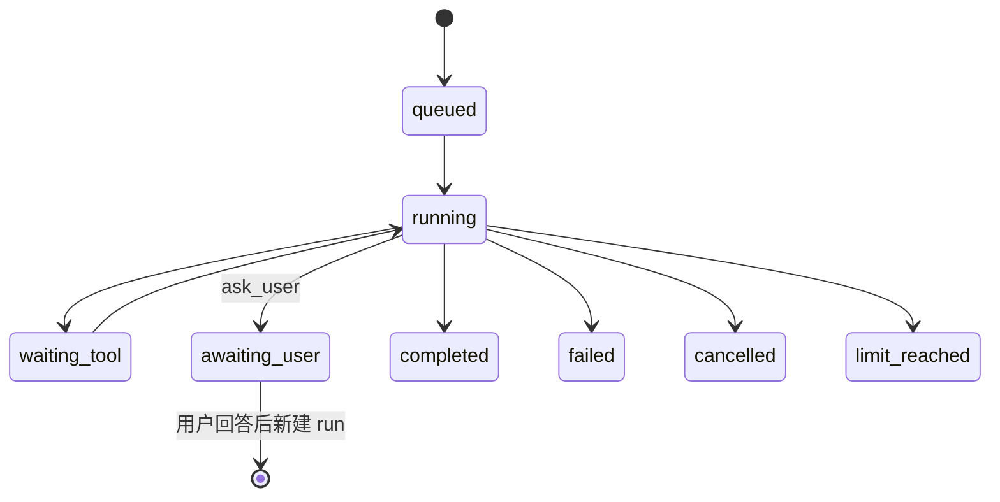

# 人机协同：`ask_user` 与 `awaiting_user`

> 目标：模型缺少必须由用户确认的信息时，**显式暂停**，而不是硬猜一个范围继续跑，最后把结果记成 `completed`。

## 0. 解决什么问题

此前有两类“人工介入”：

- **写操作审批**：`submit_changes` 前弹审批卡，用户在**执行中途**决定是否落盘。
- **正文里提问**：模型在回答末尾写“请补充目录”，但 run 仍然是 `completed`，报告/UI 分不清“完成”与“等人回答”。

`ask_user` 补上第二类：模型调用一个**终结性工具**，run 进入 `awaiting_user`，问题结构化落库并展示；用户回答后，用新一轮任务继续。

## 1. 状态机



- `awaiting_user` 是**终态**：本次 run 不再继续执行，也不会被启动回收当成“孤儿 running”。
- 当前**不做**断点续跑（`RESUMABLE` 仍只有 `failed` / `limit_reached`）：用户回答后提交**新一轮任务**，前端 `contextHistory` 会带上上一轮的问题与结论。
- 这样避免“resume 时重建 input 丢失 repoPath / Provider 配置”的旧问题；后续要做真正的 `answer + resume`，需要先把完整 RunInput 持久化。

## 2. 工具契约

| 项 | 值 |
|---|---|
| 工具名 | `ask_user` |
| 权限 | `agent:ask` |
| 风险等级 | `safe` |
| 终结性 | `terminal: true` |
| 可用范围 | codebase / research / misc / orchestrator 主 Agent（子 Agent 不暴露） |

参数：

| 字段 | 类型 | 约束 | 说明 |
|---|---|---|---|
| `questions` | `string[]` | 1~10 条，每条 ≤500 字 | 必须由用户回答的问题；要具体、可回答 |
| `reason` | `string?` | ≤1000 字 | 为什么必须暂停（缺哪些信息 / 确认什么） |
| `context` | `string?` | ≤2000 字 | 已确认的事实/已尝试路径，帮助用户快速回答 |

调用示例：

```json
{
  "questions": ["要分析 src/tools 还是整个仓库？", "是否允许运行测试？"],
  "reason": "范围与测试权限不明确",
  "context": "已确认仓库根目录可用。"
}
```

## 3. Runtime 行为

1. 工具执行成功且 `terminal=true`；
2. Runtime 校验 `questions` 非空（不信任工具输出），截断到 10 条 / 500 字；
3. `finalize(runId, 'awaiting_user', { emit: 'run_awaiting_user' })`；
4. `runs.status = awaiting_user`，`resultJson.awaitingUser` 保存问题、原因、背景、提问时间；
5. 事件流写入 `run_awaiting_user`（SSE 收到后关闭本轮连接）；
6. Trace 根 span 记为 `ok`，并生成“最终答案”节点；
7. 启动时的孤儿回收**排除** `awaiting_user`。

## 4. 前端行为

- 顶部状态 pill 变为琥珀色 `awaiting_user`；
- 实时卡片显示“等待你回答”，逐条列出问题、原因、背景；
- 对话记录保留这一轮，下一轮 `contextHistory` 会带上；
- 用户在输入框直接回答并提交，即为新一轮任务；
- SSE 的 `run_end` 会正常收尾，不触发断线轮询。

## 5. 与审批的区别

| | 写操作审批 | `ask_user` |
|---|---|---|
| 触发点 | 工具执行中途（`submit_changes`） | 模型判断信息不足 |
| 谁决定 | 用户批准/拒绝一次具体改动 | 用户补充信息 |
| run 状态 | 保持 `running`（预算暂停计时） | 进入 `awaiting_user` 终态 |
| 恢复方式 | 审批决定后原 run 继续 | 回答后新建 run |
| 适用 | 不可逆/敏感操作 | 范围、验收标准、偏好、权限确认 |

## 6. 边界（如实说明）

- 只有模型**显式调用** `ask_user` 才会进入该状态；如果它只是在正文里写“请补充信息”，run 仍是 `completed`。
- 不做真正的 `answer + resume`；回答通过新一轮任务继续，依赖前端 `contextHistory`（最近 10 轮 + 摘要）。
- 子 Agent 不暴露 `ask_user`：子任务缺信息时应通过 `submit_finding` 的 `escalateTo=human` 上报，由主 Agent/用户处理。
- 问题数量与长度有硬上限，避免把整个上下文塞进问题列表。

## 7. 复跑

```powershell
node --import tsx --test tests/48_awaiting_user.test.ts
```

覆盖：状态机、工具契约、Runtime 终态、结果落库/解包、`run_awaiting_user` 事件、Trace 收尾、孤儿回收排除。